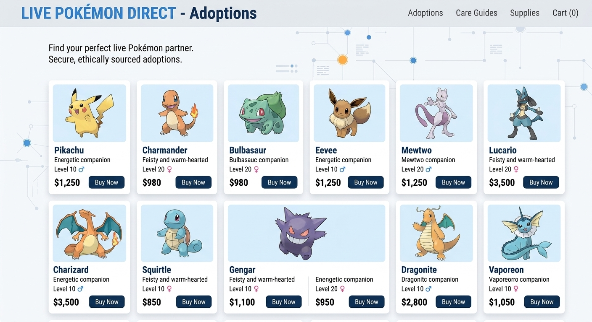

# Proyecto-DAW-POKEDEX

## INTRODUCCIÓN

El proyecto consiste en una aplicación web en la que se puede gestionar la compra y venta de distintos pokemons almacenados en una tienda. Está pensada que la use quien gestione la tienda.

## ARQUITECTURA

Para realizar este proyecto se hizo uso de diferentes técnicas de desarrollo, la primera de ellas es el __vertical slicing__, ya que con ella se puede trabajar de manera individual y aislada sin comprometer el resto del proyecto.

La segunda técnica utilizada es la __arquitectura Clean__ esta arquitectura separa el __dominio__, la __infraestructura__ y la __aplicación__, gracias a esto dividimos el trabajo, para tener que editar lo mínimo en el futuro.

De esta forma se evita romper la aplicación por completo al desacoplar los componentes.

## TECNOLOGÍAS USADAS

- Java v.17
- Springboot v.4.1.1
- Maven v.4.0.0
- Git / Github