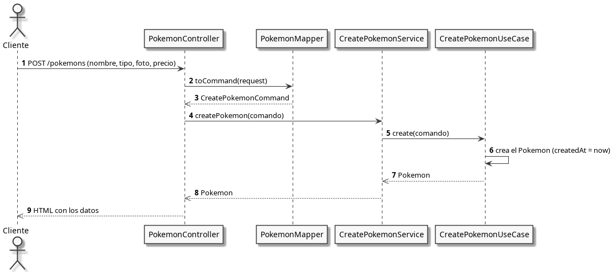

# Proyecto-DAW-POKEDEX

## Introducción

Este proyecto trata de la creación de una aplicación web que simula una tienda de compra de pokemons.

## Arquitectura

├── pokemon
│ ├── application
│ │ ├── command
│ │ │ └── CreatePokemonCommand.java
│ │ ├── service
│ │ │ ├── CreatePokemonService.java
│ │ │ └── FindPokemonService.java
│ │ └── usecase
│ │ ├── CreatePokemonUseCase.java
│ │ └── FindPokemonUseCase.java
│ ├── domain
│ │ └── model
│ │ └── Pokemon.java
│ └── infraestructure
│ ├── config
│ │ └── PokemonConfig.java
│ ├── mapper
│ │ └── PokemonMapper.java
│ └── web
│ └── mvc
│ ├── controller
│ │ └── PokemonController.java
│ └── dto
│ ├── PokemonRequest.java
│ └── PokemonResponse.java

...

### Técnicas utilizadas

Para realizar este proyecto hicimos uso de diferentes técnicas de desarrollo, la primera de ellas es el vertical slicing, ya que con ella se puede trabajar de manera individual y aislada sin comprometer el resto del proyecto y la segunda es la arquitectura Clean para separar el dominio, la infraestructura y la aplicación, gracias a esto dividimos el trabajo, para tener que editar lo mínimo en el futuro.
de esta manera evitariamos romper la aplicación por completo al desacoplar los componentes.

### Diagrama de secuencia

### Cambios a futuro

- Reestructuración del documento `README.md` en una estructura de carpetas para fomentar un ecosistema de trabajo organizado, limpio y sencillo.
- Reestructuración de la clase `Pokemon.java`.
- Eliminación de los HTML's en el controller.

